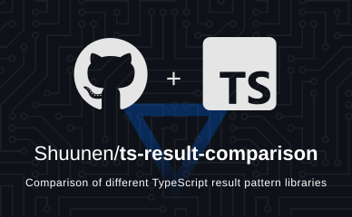

# Typescript Result Comparison

[](https://github.com/Shuunen/ts-result-comparison/blob/master/LICENSE)
[](https://hits.sh/github.com/Shuunen/ts-result-comparison/)



> Compare libraries that ease the Result pattern usage in Typescript

- [Typescript Result Comparison](#typescript-result-comparison)
  - [Demo](#demo)
  - [The result pattern](#the-result-pattern)
  - [The goal of this project](#the-goal-of-this-project)
  - [Run tests and benchmarks](#run-tests-and-benchmarks)
  - [The comparison results](#the-comparison-results)
  - [My favorite pick](#my-favorite-pick)
  - [How to contribute](#how-to-contribute)
  - [Thanks](#thanks)

## Demo



## The result pattern

It's a convention to always return a value or an error from a function.

This is a common pattern in Rust, and it's also used in other languages like Swift and Elm.

This pattern is useful because it forces the developer to handle the error case, which can help prevent bugs.

## The goal of this project

The goal is to compare different libraries and approaches to handle the Result pattern in Typescript.

It's interesting to see how each library is designed, how it's used, and how it performs.

Ideally you can use this comparison to choose the library that fits your needs the best.

## Run tests and benchmarks

Make sure you have Node.js, [pnpm](https://pnpm.io) and [Bun](https://bun.sh) (only used to run the scripts) then :

```bash
# install the dependencies
pnpm install
# run each file once just to verify that everything is working as expected
pnpm bench --runs 1
# run the benchmarks
pnpm bench --runs 50
```

Every script is taking between 79 ms (vanilla-object) and 85 ms (resultx), the difference is so small that it's not worth mentioning in the comparison table.

When running the benchmarks with Node on the built files, the results are even closer, between 163 ms and 164 ms.

## The comparison results

Here are the library used in this comparison :

- [@praha/byethrow](https://github.com/praha-inc/byethrow) v0.13.0 from PrAha, Inc.
- [fluent-type-results](https://github.com/JasonLandbridge/FluentTypeResults) v1.0.11 from Jason Landbridge
- [neverthrow](https://github.com/supermacro/neverthrow) v8.2.0 from Giorgio Delgado
- [resultx](https://github.com/johannschopplich/resultx) v2.0.2 from Johann Schopplich
- [typescript-result](https://github.com/everweij/typescript-result) v3.5.2 from Erik Verweij

| Date       | Score |       Library       | Deps |  Size  | Light | A typed | B typed | C typed | Async | Align |
| ---------- | :---: | :-----------------: | :--: | :----: | :---: | :-----: | :-----: | :-----: | :---: | :---: |
| 2026-11-06 |   5   |   @praha/byethrow   |  -1  | 1308 B |   1   |  **1**  |  **2**  |  **1**  | **1** |   0   |
| 2026-11-06 |  1.5  | fluent-type-results |  0   | 3989 B |   0   |    0    |  **1**  |   0.5   |   0   |   0   |
| 2026-11-06 |   5   |     neverthrow      |  0   | 7331 B |   0   |  **1**  |  **2**  |  **1**  | **1** |   0   |
| 2026-11-06 | **8** |       resultx       |  0   | 938 B  | **2** |  **1**  |  **2**  |  **1**  | **1** | **1** |
| 2026-11-06 |   5   |  typescript-result  |  0   | 8046 B |   0   |  **1**  |  **1**  |  **1**  | **1** | **1** |
| 2026-11-06 |   6   |   vanilla-object    |  0   | 666 B  | **2** |  **1**  |  **2**  |  **1**  |   0   |   0   |
| 2026-11-06 |   4   |    vanilla-throw    |  0   | 637 B  | **2** |  **1**  |    0    |  **1**  |   0   |   0   |

Legend :

- Deps : 1 point removed for each library dependency
- Size : the minified build size in bytes of the related file in `src`, run `pnpm build` to see by yourself
- Light : 1 point if the build is less than 2000 B, 1 bonus point if it's less than 1000 B
- A typed : 1 point if hovering `resultA.value` gives `number`
- B typed : 1 point if hovering `resultB.error` gives the type of the error, could be `string`, `string[]`, `Error`. Another 1 point if we see the literal error message.
- C typed : 1 point if hovering `resultC.value.id` gives `number`. Remove 0.5 if it's `number | something else`
- async : 1 point if a utility is provided to handle async functions easily
- align : 1 point if a utility is provided to align ok and error results, so in the end we can `const { error, value } = anyResult` or `const { ok, error, value } = anyResult`

## My favorite pick

ResultX is clearly my favorite, it has the smallest footprint, it's typed correctly and has everything needed.

## How to contribute

There are many ways to contribute to this project :

- Add a new library to the comparison
- Improve the comparison table, criteria, or scoring
- Improve the samples in `src`
- Find a way to enhance library isolation to have more meaningful benchmarks
- Whatever you think that could be useful

Just open an issue or a PR, I'll be happy to discuss it with you <3

## Thanks

- [Boxy Svg](https://boxy-svg.com) : simple & effective svg editor
- [Bun](https://bun.sh) : super fast runtime for JavaScript and TypeScript
- [FluentTypeResults](https://github.com/JasonLandbridge/FluentTypeResults) : for the library
- [Github](https://github.com) : for all their great work year after year, pushing OSS forward
- [Knip](https://github.com/webpro/knip) : super tool to find & fix problems
- [Oxc](https://oxc.rs) : a lovely super-fast collection of JavaScript tools written in Rust
- [Repo-checker](https://github.com/Shuunen/repo-checker) : eslint cover /src code and this tool the rest ^^
- [ResultX](https://github.com/johannschopplich/resultx) : for the library
- [Shields.io](https://shields.io) : for the nice badges on top of this readme
- [Svg Omg](https://jakearchibald.github.io/svgomg/) : the great king of svg file size reduction
- [Typescript Result](https://github.com/everweij/typescript-result) : for the library
- [V8](https://github.com/demurgos/v8-coverage) : simple & effective cli for code coverage
- [Vitest](https://github.com/vitest-dev/vitest) : super fast vite-native testing framework


